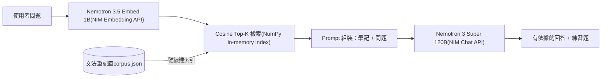

# LinguaRAG — RAG Language Tutor on NVIDIA NIM

以 **NVIDIA NIM API** 打造的檢索增強（RAG）語言學習助手。使用者提問文法問題，系統從文法筆記庫中檢索最相關的內容，交給 Nemotron 模型生成有依據、附練習題的回答。

**Live Hugging Face Space:** <https://huggingface.co/spaces/junbin666/nim-rag-language-tutor>

*A retrieval-augmented language tutor: grammar questions are answered by Nemotron, grounded on notes retrieved via NV-EmbedQA embeddings — all served through NVIDIA NIM endpoints.*

## Why NIM?

| 考量 | NIM 的答案 |
|------|-----------|
| 開發速度 | OpenAI 相容 API，一行改 `base_url` 即可切換 |
| 模型選擇 | 同一端點可切換 Nemotron / Llama / Mistral 等模型 |
| 部署彈性 | 原型用雲端 API，量產可將同一 NIM 容器部署到自有 GPU，程式碼不變 |
| 成本 | build.nvidia.com 提供免費開發額度 |

## Architecture



## Quick Start

```bash
pip install -r requirements.txt
export NVIDIA_API_KEY=nvapi-...   # free key: https://build.nvidia.com

# 建立索引（首次會自動建立）
python src/rag_tutor.py --build-index

# 提問
python src/rag_tutor.py "現在完成式跟過去式差在哪？"
python src/rag_tutor.py "日文的は和が怎麼分？"
```

輸出會先顯示檢索到的筆記與相似度分數，再給出 grounded 回答。

預設模型可用環境變數替換：

```bash
export NIM_EMBED_MODEL=nvidia/nemotron-3.5-embed-1b
export NIM_CHAT_MODEL=nvidia/nemotron-3-super-120b-a12b
```

舊版 `nv-embedqa-e5-v5` 與 `llama-3.1-nemotron-70b-instruct` hosted
endpoint 已被 NVIDIA 標示 deprecated，因此 v2 預設值已遷移。模型可用性仍可能改變，部署時請以 NVIDIA API Catalog 為準。

## Hugging Face backend deployment

`app.py` 提供 Gradio server-side UI。將 repository 發布成 Gradio Space，並在
**Settings → Variables and secrets** 新增 `NVIDIA_API_KEY`。金鑰不會出現在
browser bundle、Git history 或 UI output。

若尚未設定 secret，Space 會保留 deterministic offline demo，並清楚顯示
`OFFLINE DEMO`。設定後會切換為 `LIVE NIM`，回傳：

- retrieval / generation / total latency
- input / output token usage
- embedding 與 chat model ID
- 可選的成本估算；只有設定 `NIM_INPUT_USD_PER_MTOK` 與
  `NIM_OUTPUT_USD_PER_MTOK` 時才計算，避免硬編過時價格

### Vercel fallback backend

當 Hugging Face Space 沒有 CPU quota 時，可將 `backend/` 作為獨立 FastAPI
專案部署到 Vercel：

```bash
vercel --cwd backend
```

在 Vercel project secrets 設定 `NVIDIA_API_KEY` 與
`NIM_LIVE_ENABLED=1`。公開端點具有 allow-origin、500 字輸入上限、每個 IP
每分鐘 5 次的 best-effort rate limit，以及 450 output-token 上限。真正的流量
與預算防護仍應在 NVIDIA／Vercel 帳號層設定 quota；不要把 API key 放進靜態
Space 或 Git。

## Design Notes（PM 視角）

- **Grounding 優先**：system prompt 要求模型只依據檢索筆記回答、覆蓋不到時誠實說明 — 語言學習產品最怕自信的錯誤文法。
- **刻意選擇 in-memory NumPy 索引**：10 篇筆記不需要向量資料庫。規模化路徑：>10K 筆記時換 cuVS/FAISS，介面不變。
- **場景延伸**：此原型是 [MemoLingua](https://github.com/jjfishjj) 語言學習專案的 RAG 能力驗證，下一步是接入真實使用者的錯題記錄做個人化檢索。

## Stack

Python · Gradio · NVIDIA NIM (Nemotron 3.5 Embed, Nemotron 3 Super) · NumPy · OpenAI SDK

## Related

- 本專案作者持有 NVIDIA DLI 證書：*快速開發基於大型語言模型 (LLM) 的應用程式*、*深度學習基礎理論與實踐*
- 同系列作品：[NIM 推論成本分析](https://github.com/jjfishjj/nim-inference-cost-analysis) · [cuDF 遊戲數據 benchmark](https://github.com/jjfishjj/cudf-game-analytics-benchmark)
